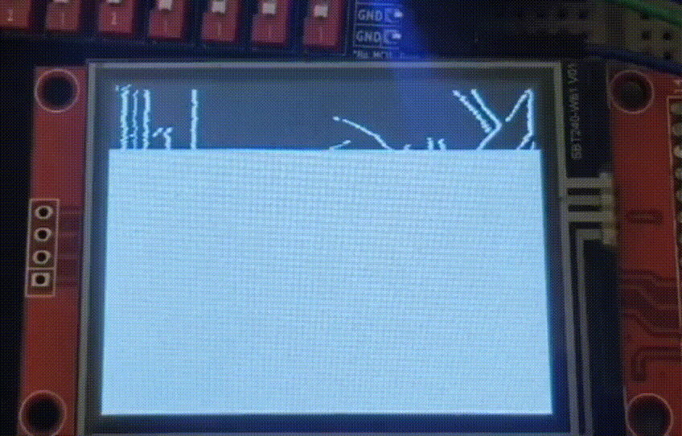
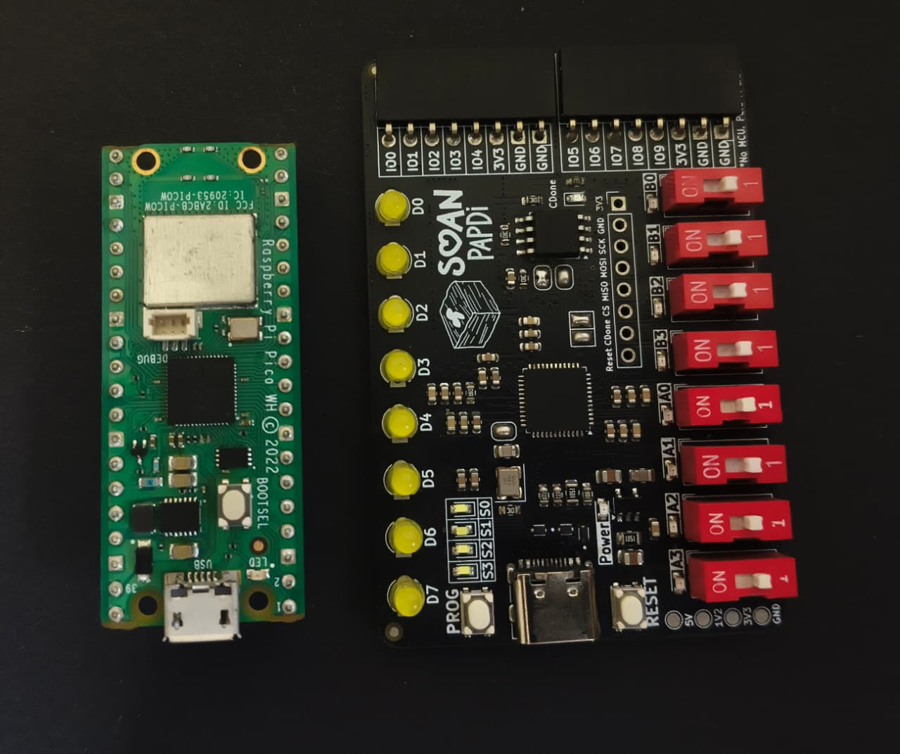
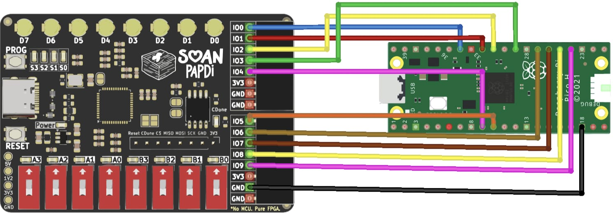
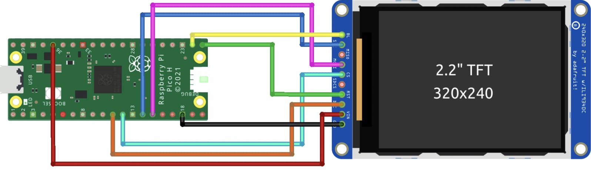
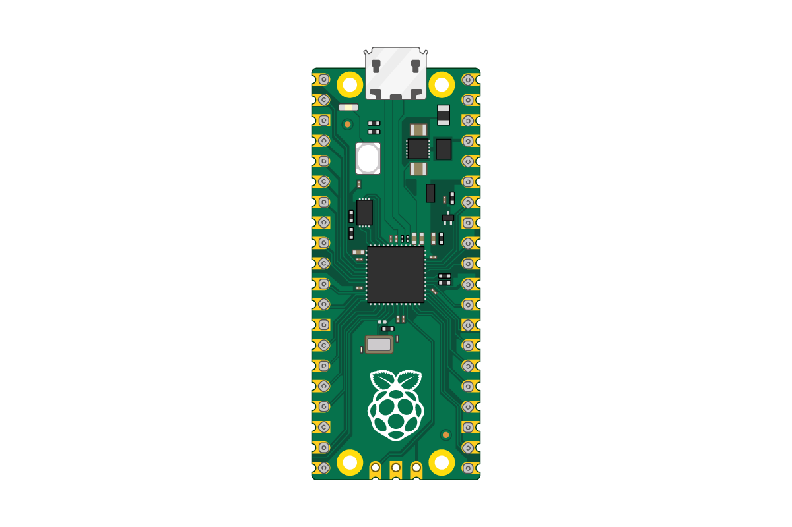
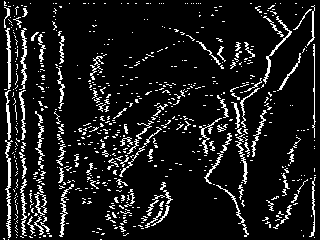
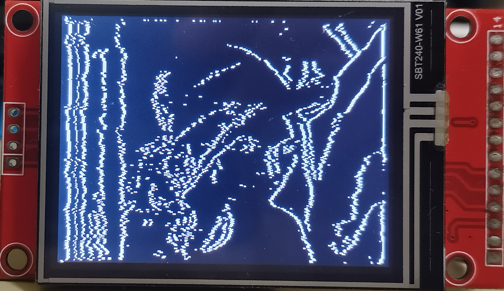
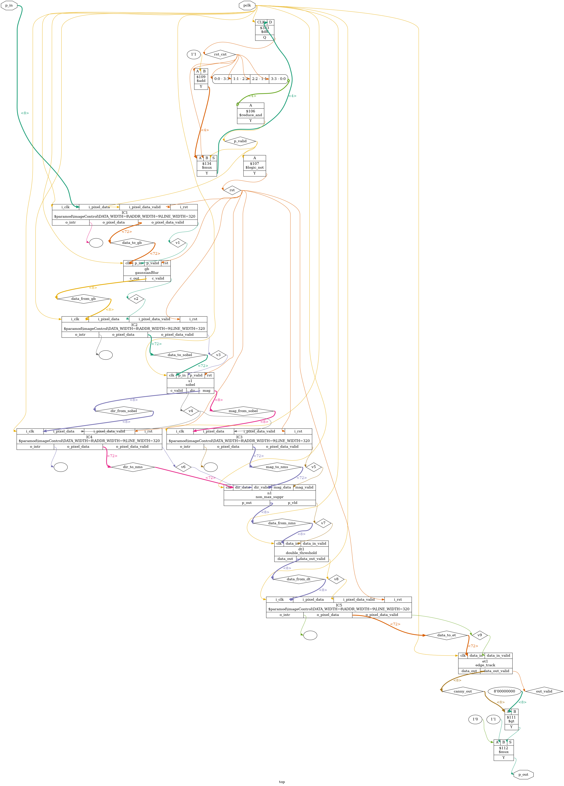

**Canny Edge Detection on Soan Papdi**

This project shows how to turn a grayscale image into clean edges using pure hardware on the Soan Papdi FPGA. An external RP2040 microcontroller streams pixels into the FPGA over a simple 8-bit parallel bus. The FPGA runs the entire Canny algorithm as a continuous pipeline and sends back a 1-bit edge result. The RP2040 then displays the edges live on an ST7789 screen and also saves them as a binary file.



### What You Need

- Soan Papdi board (iCE40 UP5K)
- Raspberry Pi Pico / RP2040 board
- ST7789 320×240 SPI display (optional)



{}

### Step 1: Hardware Connections

#### FPGA (Soan Papdi) ↔ RP2040 {class="no-step-marker"}

| Signal  | FPGA GPIO | RP2040 GPIO | Direction     |
| ------- | --------- | ----------- | ------------- |
| pclk    | 28        | 28          | RP2040 → FPGA |
| p_in[0] | 27        | 27          | RP2040 → FPGA |
| p_in[1] | 26        | 26          | RP2040 → FPGA |
| p_in[2] | 25        | 22          | RP2040 → FPGA |
| p_in[3] | 23        | 6           | RP2040 → FPGA |
| p_in[4] | 13        | 7           | RP2040 → FPGA |
| p_in[5] | 21        | 21          | RP2040 → FPGA |
| p_in[6] | 20        | 20          | RP2040 → FPGA |
| p_in[7] | 19        | 19          | RP2040 → FPGA |
| p_out   | 18        | 18          | FPGA → RP2040 |



#### ST7789 Display (SPI) ↔ RP2040 {class="no-step-marker"}

| Signal   | RP2040 GPIO |
| -------- | ----------- |
| LCD_SCK  | 10          |
| LCD_MOSI | 11          |
| LCD_CS   | 9           |
| LCD_DC   | 8           |
| LCD_RST  | 16          |
| LCD_BL   | 17          |
| VCC      | 3V3         |
| GND      | GND         |



{}
Power both boards from USB, and make sure the grounds are connected together.
{}

### Step 2: Clone the Example Project

```bash
git clone git@github.com:hardik1975/soan-papdi-examples.git
cd soan-papdi-examples/06-Canny-edge-detection
```

### Step 3: Prepare Your Input Image

The FPGA expects a raw binary file of a **320×240 grayscale** image.

```bash
python png2bin.py my_image.png input.bin
```
This resizes it to exactly **320 × 240** pixels, converts it to grayscale and finally changes it to a binary format the RP2040 can stream:

Copy this `input.bin` file onto the RP2040.

### Step 4: Project Files Explained

#### 1. `apio.ini` {class="no-step-marker"}
```ini
[env:default]
board = soan-papdi
top-module = top
```
- `board = soan-papdi` → targets the Soan Papdi board  
- `top-module = top` → the main Verilog module that ties everything together

#### 2. `pin.pcf` {class="no-step-marker"}
This file connects the names used in Verilog to the actual pins on the board.

```pcf
set_io pclk 28

# Parallel pixel bus from RP2040
set_io p_in[0] 27
set_io p_in[1] 26
set_io p_in[2] 25
set_io p_in[3] 23
set_io p_in[4] 13
set_io p_in[5] 21
set_io p_in[6] 20
set_io p_in[7] 19

# Edge result back to RP2040
set_io p_out 18
```

#### 3. Verilog Files (the hardware pipeline) {class="no-step-marker"}

```
| File                 | What it does                                           |
| -------------------- | ------------------------------------------------------ |
| `top.v`              | Connects all stages together                           |
| `imageControl.v`     | Creates the sliding 3×3 windows from the pixel stream  |
| `gaussianBlur.v`     | 3×3 Gaussian blur (noise reduction)                    |
| `sobel.v`            | Calculates gradient magnitude + direction              |
| `non_max_suppr.v`    | Thins edges to single-pixel width                      |
| `double_threshold.v` | Marks strong / weak / background pixels                |
| `edge_track.v`       | Hysteresis – keeps weak edges connected to strong ones |
```

Everything is designed as a continuous pipeline. Pixels flow in, and a few clock cycles later a 1-bit "edge or not" decision comes out.

### Step 5: Understanding the Hardware Logic

The FPGA design is a long pipeline of 6 modules. Pixels enter from the left and a clean 1-bit edge decision comes out on the right. No full image is ever stored — only a few rows of pixels are kept in small line buffers.


  
  
  
  
  
  


Here's exactly what each module does and how it works inside the chip.

---

#### 1. `imageControl.v` – Line Buffer + 3×3 Window Generator {class="no-step-marker"}

Create a sliding 3×3 window of pixels for every new incoming pixel.

**Why needed?**  
Almost every Canny stage needs to look at a pixel and its 8 neighbours. So we must keep the previous two complete rows of the image.

**How it works:**
- Two line buffers (Block RAMs) store the last two full rows (320 pixels each for a 320-wide image).
- When a new pixel arrives, it is written into the current row buffer.
- At the same time the module outputs a 3×3 grid:

```
p11 p12 p13 ← previous-previous row
p21 p22 p23 ← previous row
p31 p32 p33 ← current row (newest pixel is p33)
```

- Special handling at the edges of the image (left/right borders and top/bottom rows) so the window doesn't go outside the picture.
- Also generates valid signals so later stages know when the window is ready.

Everything else works on the 3×3 windows it produces.

---

#### 2. `gaussianBlur.v` – 3×3 Gaussian Blur {class="no-step-marker"}

Smooth the image to remove noise before edge detection.

**How it works:**  
Uses a fixed 3×3 kernel (the integer approximation of a Gaussian):

```
1 2 1
2 4 2
1 2 1
```

- Multiplies each of the 9 pixels by its weight.
- Adds them all together.
- Divides by 16 (shift right by 4 bits).

Result = a softer version of the centre pixel.  
Noise is reduced while real edges stay mostly intact.

Output: one blurred pixel per clock cycle.

---

#### 3. `sobel.v` – Sobel Gradient (Magnitude + Direction) {class="no-step-marker"}

Find out how strong the edge is and in which direction it is pointing.

**How it works:**  
Two 3×3 kernels are applied at the same time:

**Horizontal (Gx):**
```
-1  0  +1
-2  0  +2
-1  0  +1
```

**Vertical (Gy):**
```
-1 -2 -1
 0  0  0
+1 +2 +1
```

- Calculates Gx and Gy.
- **Magnitude** ≈ |Gx| + |Gy| (Manhattan approximation of the real square-root magnitude).
- **Direction** is calculated from the signs and relative sizes of Gx and Gy, then quantized into 4 possible angles (0°, 45°, 90°, 135°).

Output for every pixel:
- Gradient magnitude (how strong the edge is)
- Direction (which way the edge is facing)

---

#### 4. `non_max_suppr.v` – Non-Maximum Suppression {class="no-step-marker"}

Thin the thick edges down to single-pixel lines.

**How it works:**
- Looks at the centre pixel's magnitude and the two neighbours that lie along the gradient direction.
- Example:
  - If direction is 0° (horizontal edge) → compare with left and right neighbours.
  - If direction is 45° → compare with the diagonal neighbours, etc.
- Only keeps the centre pixel if it is **strictly stronger** than both neighbours along that direction.
- Otherwise it is set to zero (suppressed).

---

#### 5. `double_threshold.v` – Double Thresholding {class="no-step-marker"}

Classify every pixel into one of three categories.

**How it works:**  
Two fixed threshold values are used (you can change them):

- **High threshold** → Strong edge  
- **Low threshold** → Weak edge  
- Below low threshold → Background (ignore)

Logic is very simple:

```
if magnitude >= HIGH → Strong
else if magnitude >= LOW → Weak
else → Background
```

Output is usually a 2-bit code:
- `2'b10` = Strong
- `2'b01` = Weak
- `2'b00` = Background

This stage removes most noise while keeping both definite edges and possible edges.

---

#### 6. `edge_track.v` – Hysteresis / Edge Tracking {class="no-step-marker"}

Keep weak edges only if they are connected to a strong edge.

**How it works:**
- Looks at a small neighbourhood around each weak pixel.
- If any of the 8 neighbours is a Strong edge, the weak pixel is promoted to Strong.

In a pure streaming design the module usually:
1. Marks strong edges immediately.
2. Looks left/right and at the previous row for connections.
3. Propagates the "strong" status to connected weak pixels.

Final output is a clean 1-bit signal:
- `1` = this pixel is part of a real edge
- `0` = background

---

#### How They Are Connected (`top.v`) {class="no-step-marker"}

```
Pixel stream
    ↓
imageControl     → produces 3×3 windows
    ↓
gaussianBlur     → smoothed pixels
    ↓
sobel            → magnitude + direction
    ↓
non_max_suppr    → thinned edges
    ↓
double_threshold → strong / weak / background
    ↓
edge_track       → final clean 1-bit edge
    ↓
p_out (to RP2040)
```

Each stage is pipelined so that a new result comes out every clock cycle once the pipeline is full.

### Step 6: RP2040 Firmware



The RP2040 firmware (`canny.py`) does three simple jobs:

1. Reads `input.bin`
2. Streams 8-bit pixels + clock to the FPGA
3. Collects the returning 1-bit edge stream, packs it into bytes, and:
   - Draws it on the ST7789 display (if connected)
   - Saves the result as `output_edge.bin`

### Step 7: Build & Flash the FPGA

1. Connect the Soan Papdi board to your computer via USB.
2. Put the board into Programming Mode.
3. Build the design (synthesize + place & route):

```bash
apio build
```

4. Upload the bitstream:

```bash
apio upload
```

5. Press the Reset button on the Soan Papdi after uploading.

### Step 8: Upload Firmware to the RP2040 & Run

- Open the firmware file (`canny.py`).
- Upload the firmware.
- Make sure `input.bin` is present on the RP2040.

Once both sides are programmed, the RP2040 will start streaming the image. The FPGA processes every pixel in real time and the edges appear on the ST7789 display. At the same time the RP2040 saves the result as `output_edge.bin`.

### Step 9: View the Result on Your Computer

1. Copy `output_edge.bin` from the RP2040 back to your laptop.
2. Convert the binary edge image back into a viewable PNG:

```bash
python bin2png.py output_edge.bin output.png
```

Open `output.png` and you will see the clean Canny edges produced entirely by the FPGA hardware.

{}

### Results

| Input (320×240 grayscale) | FPGA Output (clean edges) |
|---------------------------|---------------------------|
|  |  |

| Live on ST7789 |
|----------------|
| |


### Visualize the Hardware

Want to see how the counters, comparators and pipeline stages are wired inside the FPGA?

```bash
apio graph --pdf
```

This creates a schematic-style diagram of your design. Open it to explore the logic.



{}
```
| Resource      | Used    | Available | % Used |
| ------------- | ------- | --------- | ------ |
| LUTs          | 1633    | 5280      | 30%    |
| Block RAM     | 9       | 30        | 30%    |
| DSP blocks    | 2       | 8         | 25%    |
| Max frequency | ~48 MHz |           |        |
```
{}

### Blog post

[Canny Edge Detection](https://yashsharda2.github.io/posts/canny-edge-detection.html)
