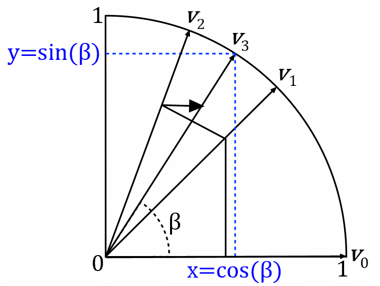
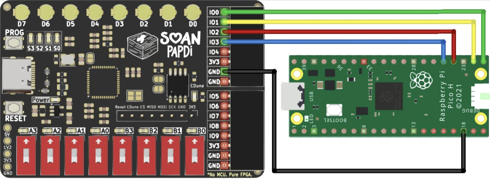
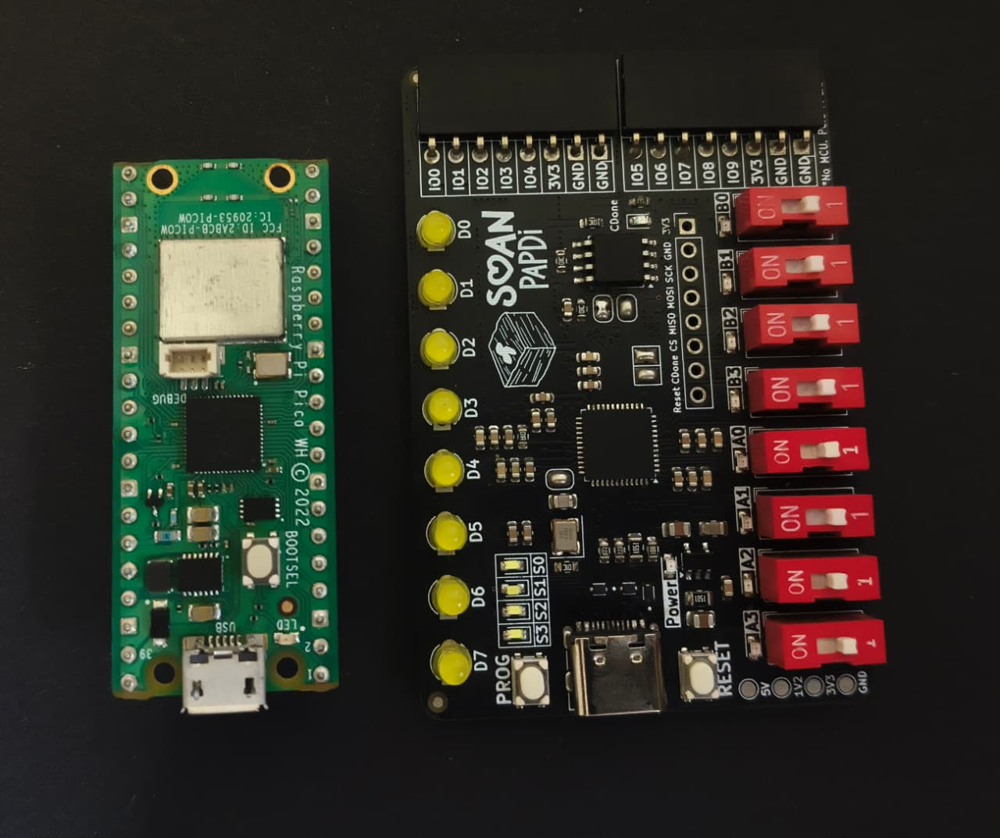
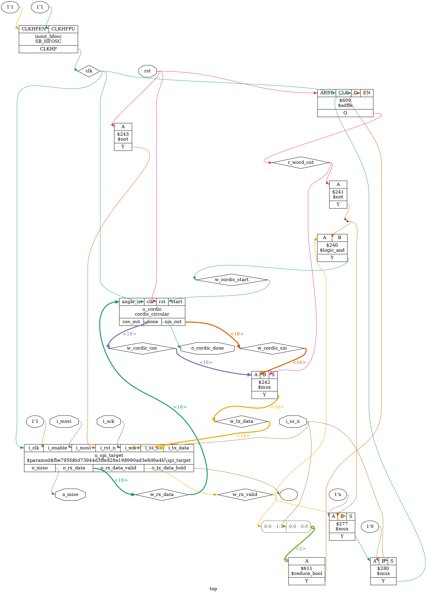

**CORDIC Sine & Cosine**

This project implements a pure hardware CORDIC engine on the Soan Papdi FPGA. It calculates sine and cosine of any angle using only shifts and adds — no multipliers, no floating-point units.

An external RP2040 (or any microcontroller) sends the angle over SPI and receives the sine and cosine results back.



### What You Need

- Soan Papdi board (iCE40 UP5K)
- Raspberry Pi Pico / RP2040 (or any MCU with SPI)

{}

### Step 1: Hardware Connections

#### FPGA (Soan Papdi) ↔ RP2040 (SPI) {class="no-step-marker"}



| Signal          | FPGA Pin | RP2040 Pin | Direction     |
|-----------------|----------|------------|---------------|
| rst             | 12       | —          | Reset button  |
| i_ss_n          | 27       | GP17       | RP2040 → FPGA |
| i_sck           | 26       | GP18       | RP2040 → FPGA |
| i_mosi          | 25       | GP19       | RP2040 → FPGA |
| o_miso          | 28       | GP16       | FPGA → RP2040 |
| o_cordic_done   | 31       | (optional) | FPGA → RP2040 |
| GND             | GND      | GND        | Common ground |

### Step 2: Clone the Example Project

```bash
git clone git@github.com:hardik1975/soan-papdi-examples.git
cd soan-papdi-examples/05-cordic
```

### Step 3: Project Files Explained

| File                | What it does |
|---------------------|--------------|
| `top.v`             | Connects the internal oscillator, SPI slave, and CORDIC engine |
| `spi_target.v`      | 16-bit SPI slave that talks to the RP2040 |
| `cordic_circular.v` | The actual CORDIC algorithm (15 iterations of shift-and-add) |
| `cordic.ino`        | RP2040 firmware that sends angles and prints results |

### Step 4: Understanding the Hardware Logic

The design has three main modules working together.


  
  
  


---

#### 1. `spi_target.v` – SPI Slave {class="no-step-marker"}

This module receives a 16-bit angle from the RP2040 and sends back the previously calculated cosine and sine.

- It synchronizes the SPI signals into the FPGA clock domain.
- It shifts in MOSI data bit by bit.
- It shifts out MISO data at the same time.
- After every 16 bits it raises a "data valid" flag.

The top module uses a simple word counter so that:
- First 16 bits → new angle comes in, cosine is sent out
- Second 16 bits → dummy data comes in, sine is sent out

This way one 32-bit SPI transaction both loads a new angle and returns the previous result.

---

#### 2. `cordic_circular.v` – The CORDIC {class="no-step-marker"}

**How CORDIC works in hardware**

Instead of calculating sine and cosine with complex formulas, CORDIC starts with a vector of known length pointing along the X-axis and rotates it step-by-step until it points at the desired angle. After the rotations, the X coordinate becomes cosine and the Y coordinate becomes sine.

Each rotation only needs a shift and an add/subtract — no multipliers are required.

**Key parts of the code:**

- **Quadrant pre-rotation**  
  Basic CORDIC only works well between –90° and +90°. Before starting the loop, the module checks the angle:
  - If the angle is > +90° → start already rotated +90° and only rotate the remaining part
  - If the angle is < –90° → start already rotated –90°
  - Otherwise start from the X-axis as normal  

  This lets the same 15-iteration loop handle the full 0°–360° range.

- **K_FACTOR**  
  Each rotation slightly lengthens the vector. After 15 iterations the vector has grown by a fixed amount (~1.647×). To compensate, the vector starts at length `K_FACTOR = 19898` (in Q1.15 fixed-point). By the end the length is back to 1.0.

- **15 iterations**  
  A small state machine runs from `i = 0` to `i = 14`. In each step it rotates by a pre-calculated angle (stored in the `atan` lookup) using only shifts (`x >>> i` and `y >>> i`) and adds/subtracts.

- **Guard bits + saturation**  
  Internal registers are 18 bits wide (two extra guard bits) to prevent overflow during calculation. At the end the `sat()` function cleanly clips the result back to 16-bit signed values.

---

#### 3. `top.v` – Putting It All Together {class="no-step-marker"}

- Instantiates the internal 24 MHz oscillator (`SB_HFOSC`)
- Instantiates the SPI slave
- Instantiates the CORDIC engine
- Manages the 32-bit SPI transaction (angle in → cosine + sine out)

### Step 5: RP2040 Firmware (`cordic.ino`)



The firmware is simple and clear:

1. You type an angle in degrees in the Serial Monitor.
2. The angle is converted to Q1.15 fixed-point format.
3. It is sent over SPI.
4. Cosine and sine come back.
5. The results are printed next to the real `sin()` and `cos()` values for comparison.

{}
**Why the angle is sent twice:** the SPI interface is pipelined. When you send a new angle, the FPGA returns the cosine and sine of the *previous* angle at the same time. That's why the firmware calls `queryCordic()` twice — the first call loads the new angle, the second receives its result.
{}

```cpp
queryCordic(angle, c_cos, c_sin);   // First call: loads the new angle
queryCordic(angle, c_cos, c_sin);   // Second call: receives the result of the previous angle
```

After the second call, `c_cos` and `c_sin` contain the correct results for the angle you just typed.

### Step 6: Build & Flash

1. Connect the Soan Papdi board to your computer via USB.
2. Put the board into Programming Mode.

3. Build the design:

```bash
apio build
```

4. Upload the bitstream:

```bash
apio upload
```

5. Press the Reset button on the Soan Papdi.

### Step 7: Upload Firmware to the RP2040

- Open `cordic.ino` in the Arduino IDE (or PlatformIO)
- Select the Raspberry Pi Pico board
- Upload the sketch
- Open the Serial Monitor at 115200 baud and start typing angles

{}

### Output

```
CORDIC
Enter angle in degrees:
Angle | CORDIC Cos | Actual Cos | Cos Error | CORDIC Sin | Actual Sin | Sin Error
32.0  | 0.8480     | 0.8480     | 0.00000   | 0.5300     | 0.5299     | 0.00010
90.0  | 0.0000     | -0.0000    | 0.00000   | 1.0000     | 1.0000     | 0.00000
9.0   | 0.9877     | 0.9877     | 0.00001   | 0.1564     | 0.1564     | 0.00003
23.0  | 0.9205     | 0.9205     | 0.00004   | 0.3908     | 0.3907     | 0.00009
89.0  | 0.0175     | 0.0175     | 0.00003   | 0.9998     | 0.9998     | 0.00003
130.0 | -0.6428    | -0.6428    | 0.00005   | 0.7660     | 0.7660     | 0.00009
270.0 | 0.0002     | 0.0000     | 0.00015   | -1.0000    | -1.0000    | 0.00003

```

### Visualize the Hardware

```bash
apio graph --pdf
```

This creates a diagram of the CORDIC state machine and the SPI logic in the `_build` folder.



---
