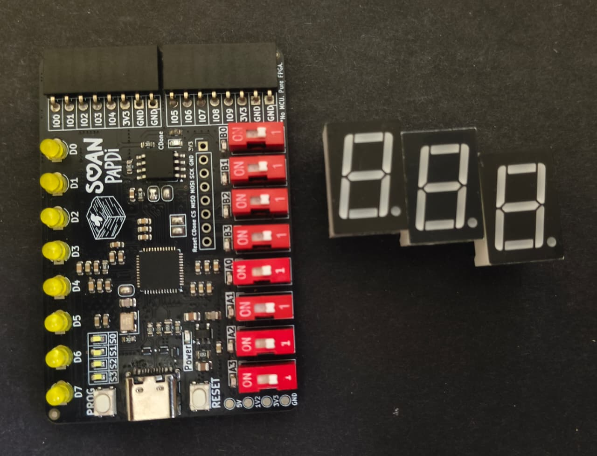
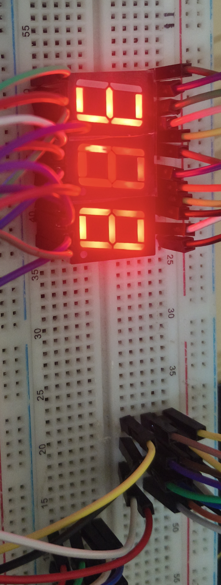
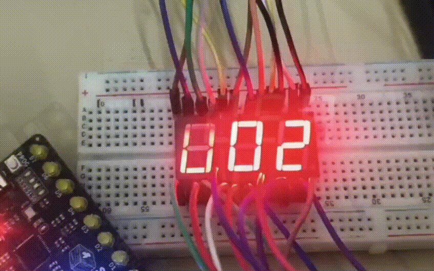
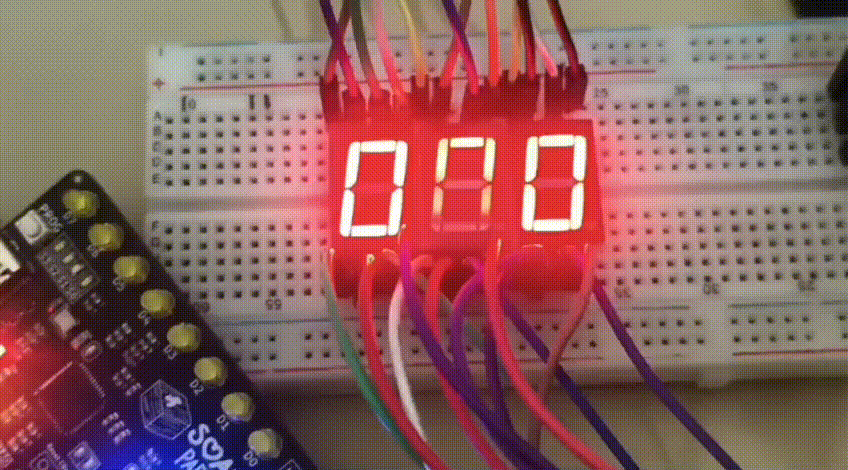
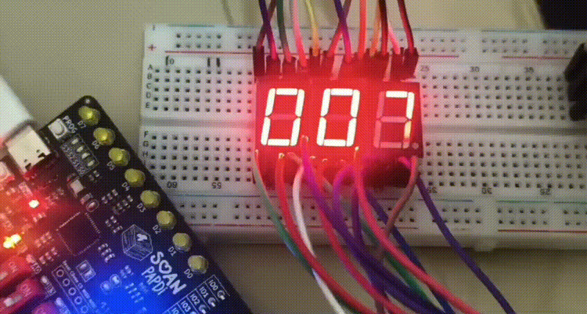
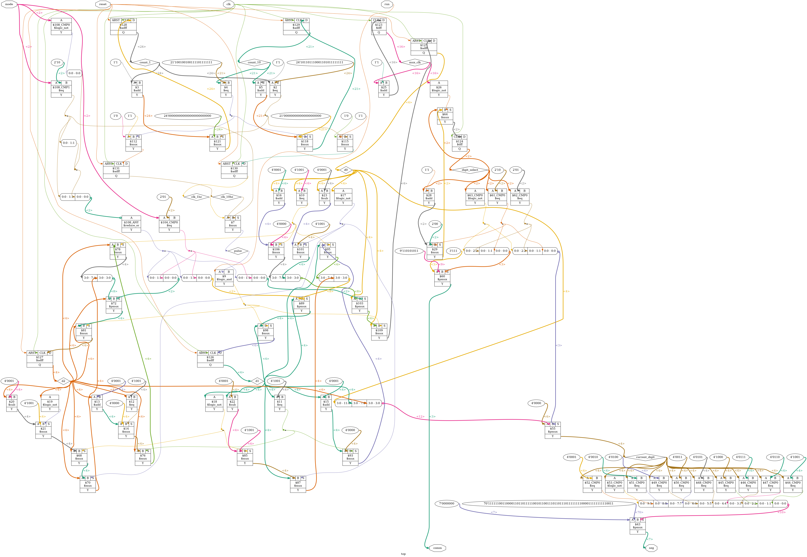

**Soan Papdi – Up/Down Counter & Stopwatch**

This project turns the Soan Papdi board into a 3-digit counter that displays on a common-cathode 7-segment display.  
It can count up, count down, or act as a stopwatch (counting in 0.1 second steps). You can start/pause it and reset it back to zero using the onboard switches and buttons.



### What You Need

- Soan Papdi board (iCE40 UP5K)
- 3-digit common-cathode 7-segment display

{}

### Step 1: Hardware Connections

#### FPGA → 7-Segment Display {class="no-step-marker"}

| Signal  | FPGA Pin | Description                          |
|---------|----------|--------------------------------------|
| clk     | 35       | Onboard 12 MHz clock                 |
| mode[0] | 3        | Mode select bit 0                    |
| mode[1] | 48       | Mode select bit 1                    |
| run     | 4        | Run / Pause button                   |
| reset   | 12       | Reset button                         |
| comm[0] | 18       | Digit 1 common (rightmost digit)     |
| comm[1] | 19       | Digit 2 common (middle digit)        |
| comm[2] | 20       | Digit 3 common (leftmost digit)      |
| seg[0]  | 28       | Segment g                            |
| seg[1]  | 27       | Segment f                            |
| seg[2]  | 26       | Segment e                            |
| seg[3]  | 25       | Segment d                            |
| seg[4]  | 23       | Segment c                            |
| seg[5]  | 13       | Segment b                            |
| seg[6]  | 21       | Segment a                            |



{}
`comm` is **active-low** (a digit turns on when its line goes low), `seg` is **active-high**. Put a 220–330 Ω resistor on each of the 7 segment lines to limit current.
{}

### Step 2: Clone the Example Project

```bash
git clone git@github.com:hardik1975/soan-papdi-examples.git
cd soan-papdi-examples/04-counter
```

### Step 3: Project Files Explained

| File     | What it does |
|----------|--------------|
| `top.v`  | Complete design: clock dividers, the actual counter, digit multiplexing, and 7-segment decoding |
| `pin.pcf`| Maps all signal names to the real pins on the Soan Papdi board |

### Step 4: Understanding the Hardware Logic

The whole design lives in a single file (`top.v`) and is divided into four clear parts.


  
  
  
  


---

#### 1. Clock Divider {class="no-step-marker"}

The board clock runs at 12 MHz. We need much slower ticks:

- **1 Hz tick** → for normal up/down counting (once per second)
- **10 Hz tick** → for stopwatch mode (tenths of a second)

Two counters divide the 12 MHz clock down to these two rates.  
A simple multiplexer chooses which tick to use depending on the mode.

```verilog
wire pulse = (mode == 2'b10) ? clk_10hz : clk_1hz;
```

---

#### 2. The Counter (BCD) {class="no-step-marker"}

Three 4-bit registers hold the digits:

- `d0` → ones (0–9)
- `d1` → tens (0–9)
- `d2` → hundreds (0–9)

**Behaviour according to mode**

| mode | Behaviour |
|------|-----------|
| 00   | Count **up** once per second |
| 01   | Count **down** once per second |
| 10   | Stopwatch – count **up** 10 times per second |

When `run` is high and a pulse arrives, the counter updates.  
When `reset` is pressed, all three digits go back to 0.

The counting logic correctly handles the carry (9 → 0 and increment next digit) for both up and down directions.

---

#### 3. Digit Multiplexing {class="no-step-marker"}

A 7-segment display has only one set of 7 segment pins, but we have 3 digits.  
The solution is **time-division multiplexing**:

1. Light digit 0 (right) for a short time  
2. Light digit 1 (middle) for a short time  
3. Light digit 2 (left) for a short time  
4. Repeat very fast

The `comm` signals select which digit is currently active (active-low).

---

#### 4. 7-Segment Decoder {class="no-step-marker"}

Whatever digit is currently selected is converted from its BCD value (0–9) into the correct pattern of the 7 segments (a–g).


Example patterns:

```
0 → 1111110
1 → 0110000
2 → 1101101
...
9 → 1110011
```

### Step 5: Mode Selection

Use the two mode switches:

| mode[1:0] | Function |
|-----------|----------|
| 00        | Count up (1 second steps) |
| 01        | Count down (1 second steps) |
| 10        | Stopwatch (0.1 second steps) |

**Count up**



**Count down**



**Stopwatch**



- `run = 1` → counter runs  
- `run = 0` → counter pauses  
- `reset = 1` → everything goes back to 000

### Step 6: Build & Flash

1. Connect the Soan Papdi board to your computer via USB.
2. Put the board into Programming Mode.

3. Build the design:

```bash
apio build
```

4. Upload the bitstream:

```bash
apio upload
```

5. Press the Reset button on the Soan Papdi.

### Step 7: How to Use It

1. Set the mode switches to choose Up / Down / Stopwatch.
2. Press the **run** button to start counting.
3. Press **run** again to pause.
4. Press **reset** to go back to 000.

{}

### Visualize the Hardware

```bash
apio graph --pdf
```

This generates a diagram of the counters, multiplexers and decoder in the `_build` folder.



---
