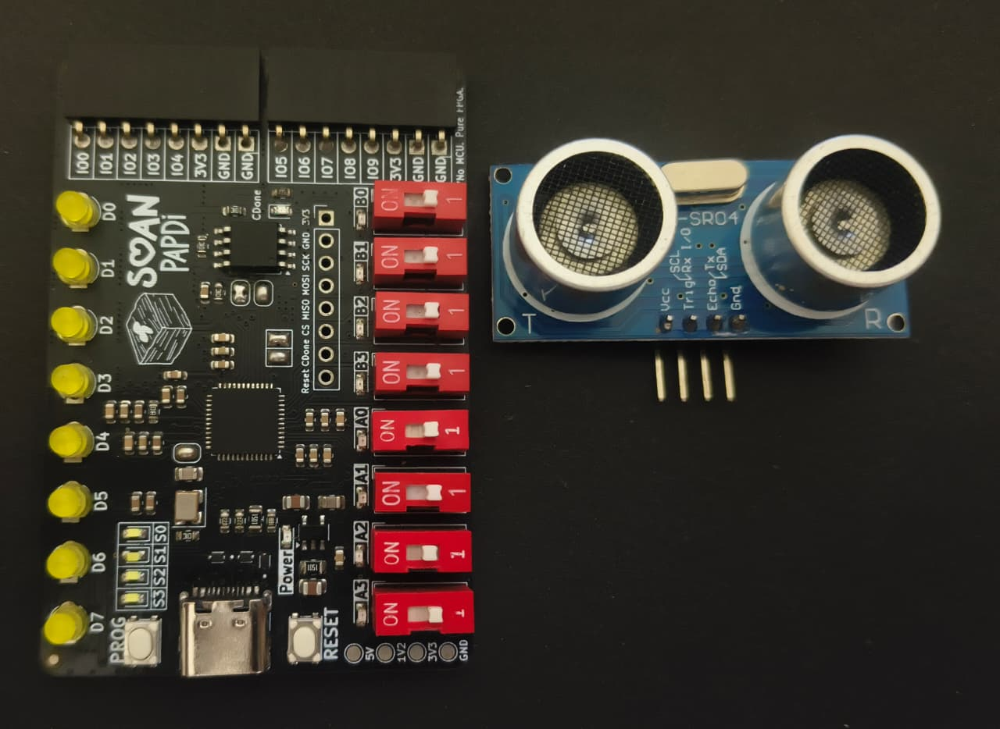
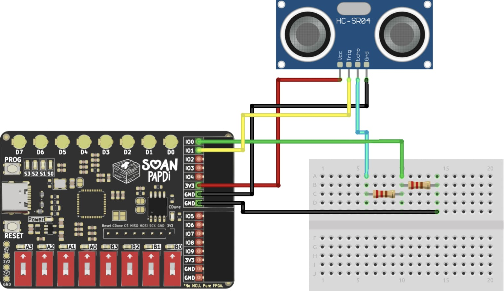
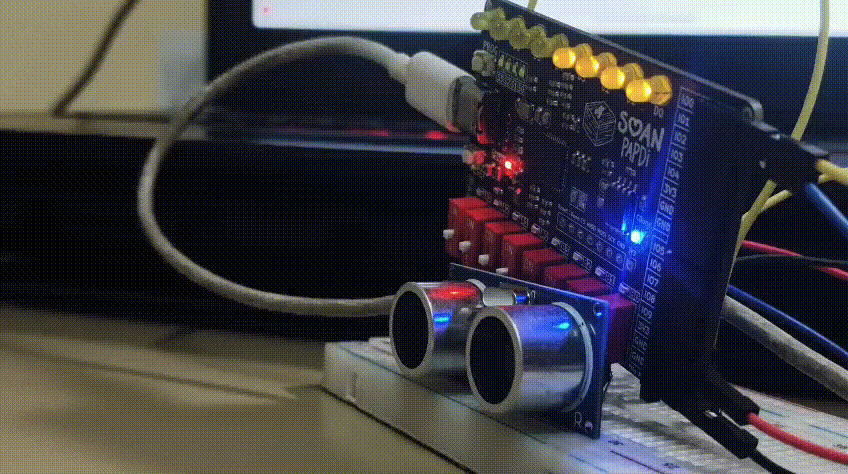
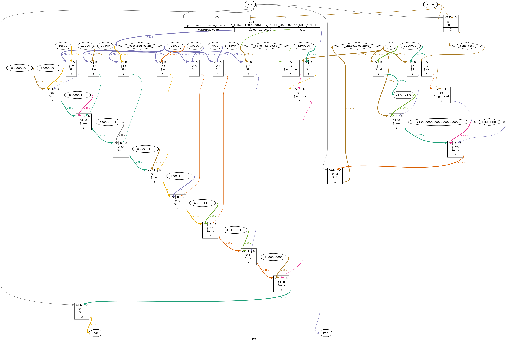

**Soan Papdi – HC-SR04 Ultrasonic Distance Sensor**

This project reads distance from an HC-SR04 ultrasonic sensor using the Soan Papdi board and lights up the 8 onboard LEDs like a distance meter.  
As an object gets closer to the sensor, more LEDs turn on one by one.



### What You Need

- Soan Papdi board (iCE40 UP5K)
- HC-SR04 ultrasonic sensor
- 1 kΩ resistor
- 2 kΩ resistor

{}

### Step 1: Hardware Connections

{}
**Protect your FPGA pin!** The HC-SR04 runs on 5 V, so its Echo pin outputs 5 V signals. The iCE40UP5K inputs only accept 3.3 V maximum. You **must** use a voltage divider.
{}

```
HC-SR04 Echo (5V) ──[ 1 kΩ ]──┬── FPGA pin (3.3 V)
                              │
                           [ 2 kΩ ]
                              │
                             GND
```

#### Pin Mapping {class="no-step-marker"}



| Signal    | FPGA Pin | Description                              |
|-----------|----------|------------------------------------------|
| clk       | 35       | Onboard 12 MHz clock                     |
| trig      | 27       | HC-SR04 Trig pin                         |
| echo      | 28       | HC-SR04 Echo pin (through voltage divider) |
| leds[7:0] | D0–D7    | Onboard LEDs                             |
| VCC       | 3V3      | HC-SR04 VCC                              |
| GND       | GND      | Common ground                            |

### Step 2: Clone the Example Project

```bash
git clone git@github.com:hardik1975/soan-papdi-examples.git
cd soan-papdi-examples/03-ultrasonic
```

### Step 3: Project Files Explained

| File                  | What it does |
|-----------------------|--------------|
| `top.v`               | Takes the measured distance and turns the 8 LEDs on/off like a bar-graph distance meter |
| `ultrasonic_sensor.v` | Sends the 10 µs trigger pulse and measures how long the Echo pin stays high |
| `pin.pcf`             | Maps signal names to the real pins on the Soan Papdi board |

### Step 4: Understanding the Hardware Logic

The design has two modules working together.


  
  


---

#### 1. `ultrasonic_sensor.v` – The Sensor Driver {class="no-step-marker"}

This module talks to the HC-SR04 and calculates distance.

**How the HC-SR04 works**
1. FPGA sends a short 10 µs pulse on the `trig` pin.
2. The sensor sends out an ultrasonic burst.
3. When the echo returns, the sensor pulls the `echo` pin high.
4. The time the `echo` pin stays high is proportional to the distance.

**What the module does**

- Every 60 ms it generates a clean 10 µs trigger pulse.
- It counts how many clock cycles the `echo` pin stays high.
- It converts that count into a distance value (using the speed of sound).
- It also has a simple debounce so the reading doesn't flicker.

Key parameters you can change:

```verilog
CLK_FREQ      = 12_000_000   // 12 MHz clock
TRIG_PULSE_US = 10           // 10 µs trigger
MAX_DIST_CM   = 40           // maximum distance we care about
```

---

#### 2. `top.v` – Distance Meter Logic {class="no-step-marker"}

This module takes the raw count from the sensor and lights the LEDs.

**Distance zones (0 – 40 cm)**

| Distance Range     | LEDs that light up |
|--------------------|--------------------|
| 0 – 5 cm           | All 8 LEDs         |
| 5 – 10 cm          | 7 LEDs             |
| 10 – 15 cm         | 6 LEDs             |
| 15 – 20 cm         | 5 LEDs             |
| 20 – 25 cm         | 4 LEDs             |
| 25 – 30 cm         | 3 LEDs             |
| 30 – 35 cm         | 2 LEDs             |
| 35 – 40 cm         | 1 LED              |
| > 40 cm or no object | All LEDs off     |

It also has a timeout: if no valid echo is received for 100 ms, all LEDs turn off.

### Step 5: Build & Flash

1. Connect the Soan Papdi board to your computer via USB.
2. Put the board into Programming Mode.

3. Build the design:

```bash
apio build
```

4. Upload the bitstream:

```bash
apio upload
```

5. Press the Reset button on the Soan Papdi.

### Step 6: Test It



- Place your hand or an object in front of the sensor.
- As you move closer, more LEDs will light up one by one.
- When the object is very close (under ~5 cm), all 8 LEDs should be on.
- When nothing is in range, all LEDs turn off.

{}

### Visualize the Hardware

```bash
apio graph --pdf
```

This creates a diagram of the logic in the `_build` folder so you can see the counters and state machines.



---
