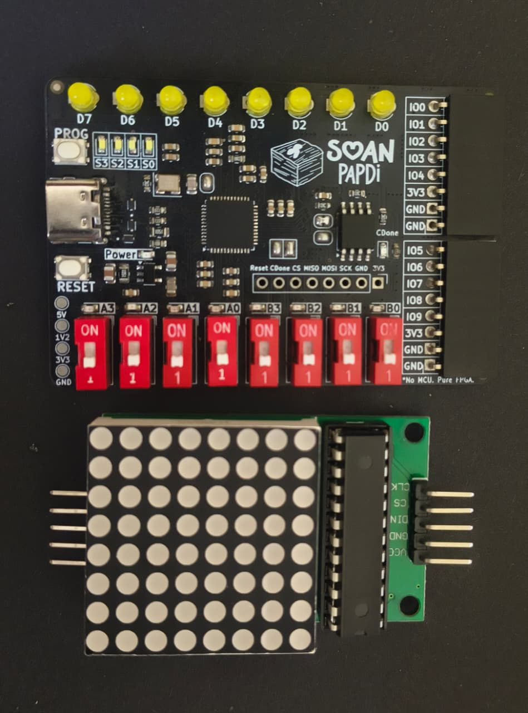
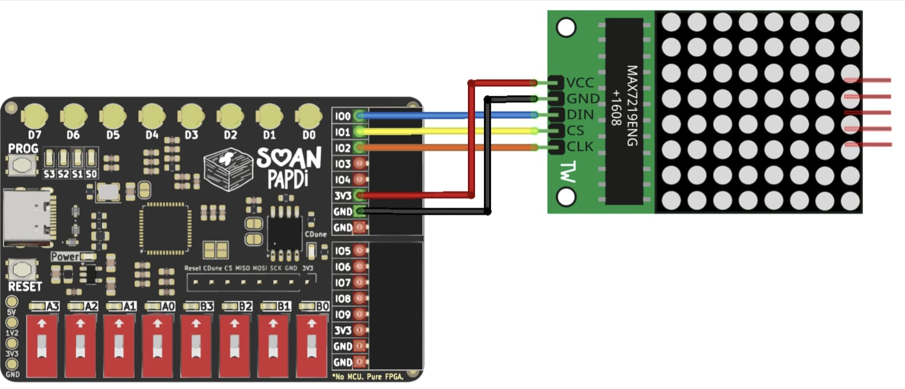
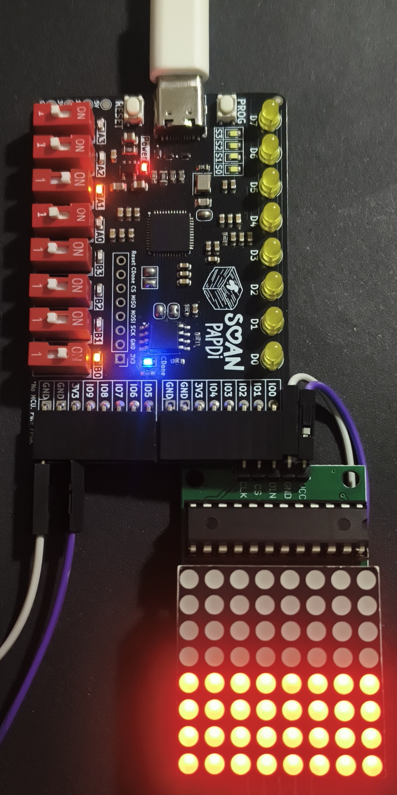
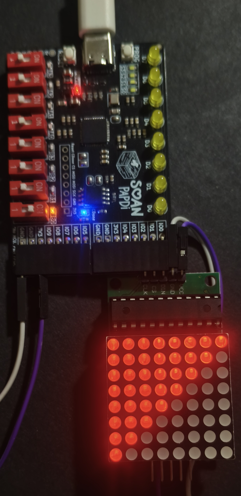
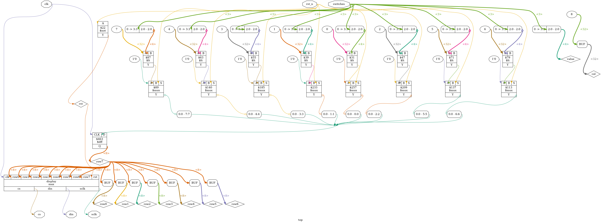

**Soan Papdi – MAX7219 8×8 LED Matrix**

This project drives an 8×8 LED matrix using a MAX7219 driver chip with the Soan Papdi board. Three onboard slide switches set a value from 0 to 7, and that value is shown as a bar graph on the matrix by default. You can also switch to a fixed pattern or a moving-dot animation just by changing a few lines of code.



### What You Need

- Soan Papdi board (iCE40 UP5K)
- MAX7219 8×8 LED matrix module

{}

### Step 1: Hardware Connections

#### FPGA (Soan Papdi) ↔ MAX7219 {class="no-step-marker"}



| Signal | FPGA Pin | MAX7219 Pin     |
|--------|----------|-----------------|
| din    | 28       | DIN             |
| sclk   | 26       | CLK             |
| cs     | 27       | CS / LOAD       |
| —      | —        | VCC → 5V or 3.3V|
| —      | —        | GND → GND       |

#### Onboard Switches (for bar graph mode) {class="no-step-marker"}

| Signal      | FPGA Pin |
|-------------|----------|
| switches[0] | 48       |
| switches[1] | 3        |
| switches[2] | 4        |

### Step 2: Clone the Example Project

```bash
git clone git@github.com:hardik1975/soan-papdi-examples.git
cd soan-papdi-examples/02-Max7219_LedMatrix
```

### Step 3: Project Files Explained

#### 1. `apio.ini` {class="no-step-marker"}
```ini
[env:default]
board = soan-papdi
top-module = top
```

#### 2. `pin.pcf` {class="no-step-marker"}
```pcf
set_io clk 35
set_io rst_n 12
set_io din 28
set_io sclk 26
set_io cs 27
set_io switches[0] 48
set_io switches[1] 3
set_io switches[2] 4
```

#### 3. Verilog Files {class="no-step-marker"}

| File    | What it does |
|---------|--------------|
| `top.v` | Reads the switches and creates the eight rows of LED data (`row0`–`row7`). All patterns and animations live here. |
| `max.v` | Handles MAX7219 initialization and continuously sends the row data over SPI. |

### Step 4: Understanding the Hardware Logic

- `top.v` decides **what** pattern to show.
- `max.v` takes that pattern and **sends** it to the LED matrix.


  
  


---

#### 1. `max.v` – The MAX7219 Driver {class="no-step-marker"}

This module does two things:

**A. SPI Bit-Banging**

It shifts out 16 bits (8-bit address + 8-bit data) one bit at a time:

- Puts the next bit on the `din` pin
- Toggles `sclk`
- Pulls `cs` low while sending and high when finished

This is a small state machine that creates a complete SPI in pure hardware.

**B. Initialization + Continuous Refresh Sequencer**

On reset it sends the required configuration commands to the MAX7219:

- Decode mode off
- Scan limit = 7 (all 8 rows)
- Shutdown mode off (normal operation)
- Intensity setting
- Display test off

After initialization it enters a continuous loop that keeps sending the current values of `row0` to `row7`.

---

#### 2. `top.v` – Pattern Generator {class="no-step-marker"}

This is where all the creativity happens. It creates eight registers:

```verilog
reg [7:0] row0, row1, row2, row3, row4, row5, row6, row7;
```

Each bit in these registers controls one LED (1 = on, 0 = off).

{}
Three different modes are provided below. **Only one mode should be active at a time** — comment out the other two blocks in `top.v` before building.
{}

**Mode 1 – Bar Graph (default, currently active)**



```verilog
wire [3:0] value = switches;

for (col = 0; col < 8; col = col + 1) begin
    row0[col] <= (col < value);
    row1[col] <= (col < value);
    // … same for all eight rows
end
```

- Reads the three switches → gets a number from 0 to 7
- Lights up that many columns from the left side of the matrix
- Simple and perfect for testing the hardware

**Mode 2 – Static Pattern (commented out)**



Uncomment this block to draw any fixed shape:

```verilog
row0 <= 8'b10000000;
row1 <= 8'b11000000;
row2 <= 8'b11100000;
row3 <= 8'b11110000;
row4 <= 8'b11111000;
row5 <= 8'b11111100;
row6 <= 8'b11111110;
row7 <= 8'b11111111;
```

Each line is one row of the matrix. Change any bit from `0` to `1` to turn that LED on.

**Mode 3 – Animation – Moving Dot (commented out)**


A free-running counter increases. From that counter the code calculates which single LED should be lit:

```verilog
wire [2:0] active_row = position[5:3];
wire [2:0] active_col = position[2:0];
```

A bright dot walks across all 64 positions of the matrix (left to right, top to bottom) and then loops forever. Because the position is calculated from a counter, you can easily change the math to create other animations.

### Step 5: Build & Flash

1. Connect the Soan Papdi board to your computer via USB.
2. Put the board into Programming Mode.

3. Build the design:

```bash
apio build
```

4. Upload the bitstream:

```bash
apio upload
```

5. Press the Reset button on the Soan Papdi.

### Step 6: Try the Other Modes

- To use the **static pattern**: comment out the bar-graph block and uncomment the static pattern block.
- To use the **moving dot**: comment out the other two blocks and uncomment the animation block.
- Rebuild and upload after every change.

{}

### Visualize the Hardware

```bash
apio graph --pdf
```

This generates a diagram of your logic in the `_build` folder so you can see how the counters and SPI engine are connected.



---
