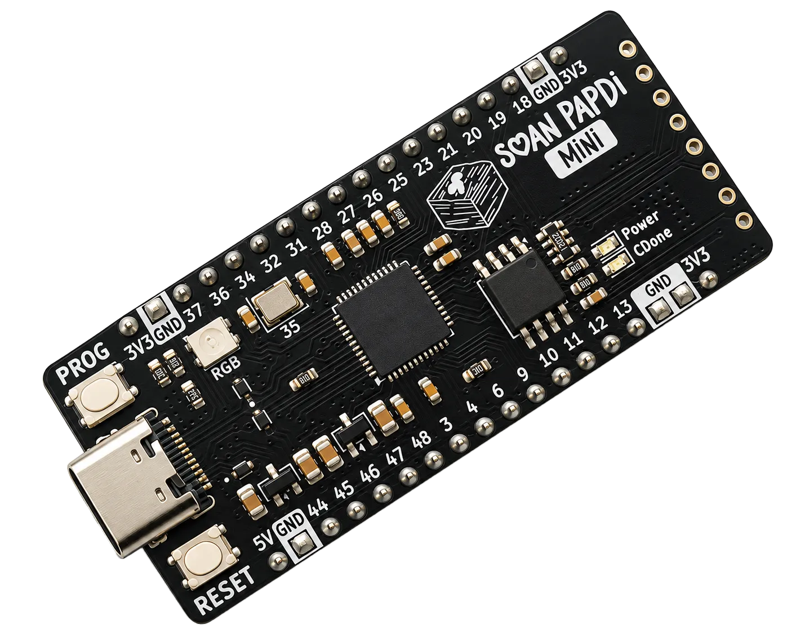

Welcome to the official **Soan Papdi Mini** documentation — a compact, breadboard-friendly **Lattice iCE40UP5K** FPGA development board built for hands-on learning, rapid prototyping, and digital logic design with an open-source FPGA toolchain.


**Compact size, full FPGA power:** \
Powered by the **Lattice iCE40UP5K** (`5,280 LUTs`), **27 breadboard-friendly GPIO pins**, an onboard **RGB LED**, **12 MHz oscillator**, and a **USB-C DFU bootloader**—programmable in seconds with 100% open-source tools on Windows, macOS, and Linux.


  <a href="/mini/hardware-overview/" style="display: inline-flex; align-items: center; gap: 8px; padding: 10px 20px; border-radius: 8px; text-decoration: none; font-weight: 600; background: var(--hextra-colors-background-secondary, #1f2937); color: var(--hextra-colors-text, #f9fafb); border: 1px solid var(--hextra-colors-border, #374151);">
     Explore Hardware & Pinout
  </a>
  <a href="https://www.ashoktinkeringlabs.com/soan-papdi-mini" target="_blank" rel="noreferrer" style="display: inline-flex; align-items: center; gap: 8px; padding: 10px 20px; border-radius: 8px; text-decoration: none; font-weight: 600; background: #3b82f6; color: white;">
     Get Soan Papdi Mini ↗
  </a>

<!-------------------------------------------------------------------------->

 

## Where Should I Start?

New to **Soan Papdi Mini**? Begin by exploring the board's pinout and hardware specs, then jump straight into your first visual circuit:


  
  


<!-------------------------------------------------------------------------->

 

## Choose Your Learning Path

You can program the **Soan Papdi Mini** visually using drag-and-drop logic blocks or directly in **Verilog HDL** from the command line. Pick the workflow that fits you best:

### 1. Visual Block Programming — iCE Studio

Ideal for beginners and visual learners. Wire up logic gates, counters, and clocks on a graphical canvas and flash your board with a single click.


  
  


### 2. Hardware Description Code — Verilog & Apio CLI

Ready to work closer to the silicon? Write synthesizable **Verilog** code and use the open-source **Apio CLI** (`Yosys` + `nextpnr`) to verify, build, and upload from your terminal.


  
  


<!-------------------------------------------------------------------------->

 

## Resources & Support

Everything you need to download software packages, look up pinouts, and solve common setup issues:


  
  

