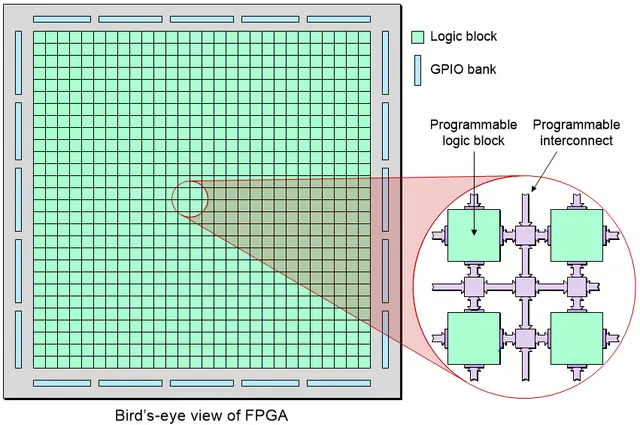
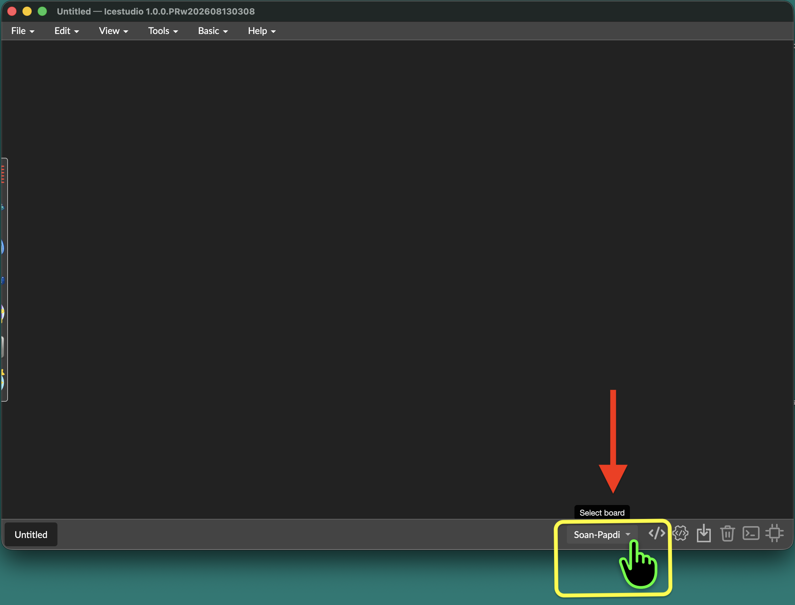
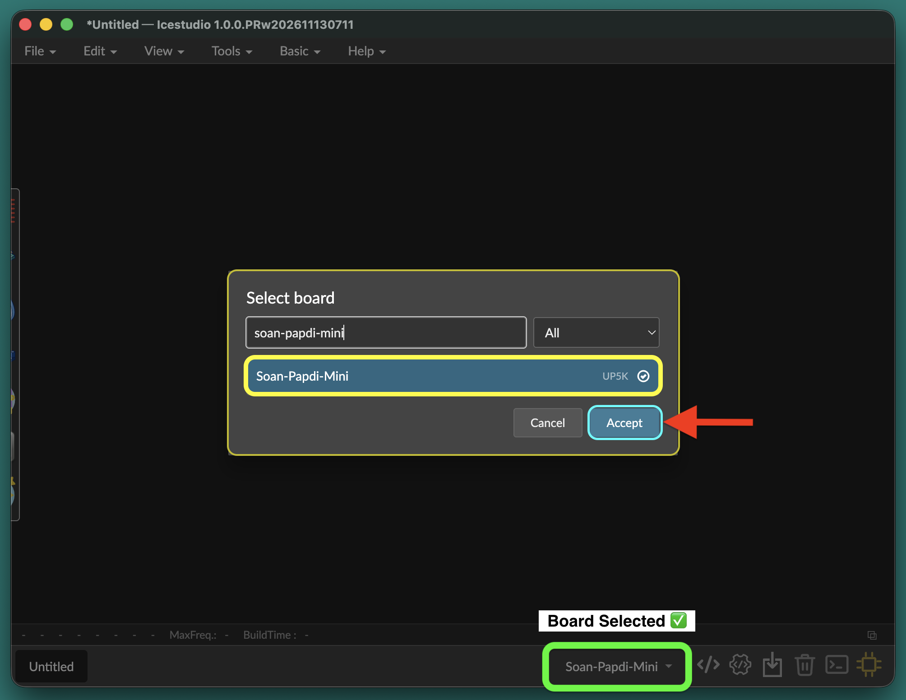
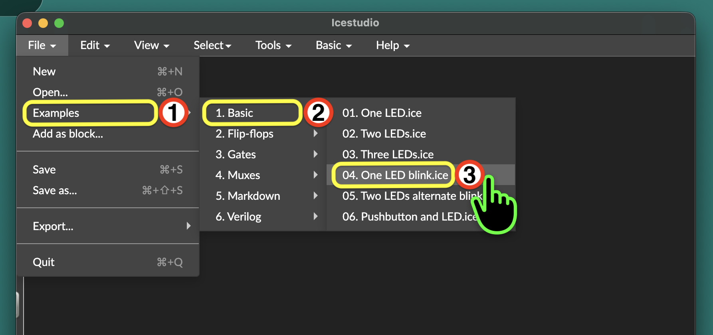
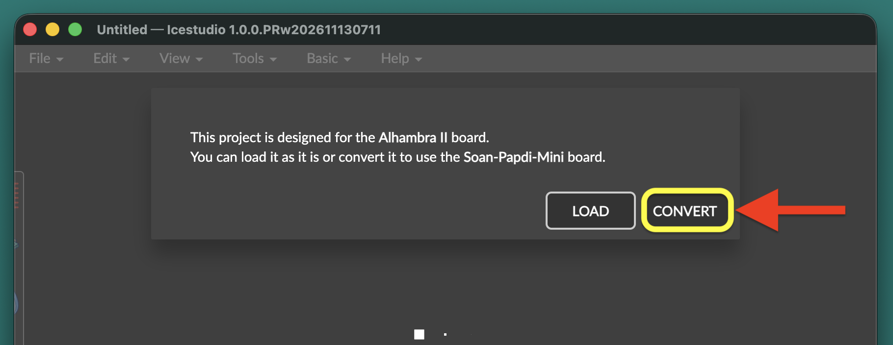
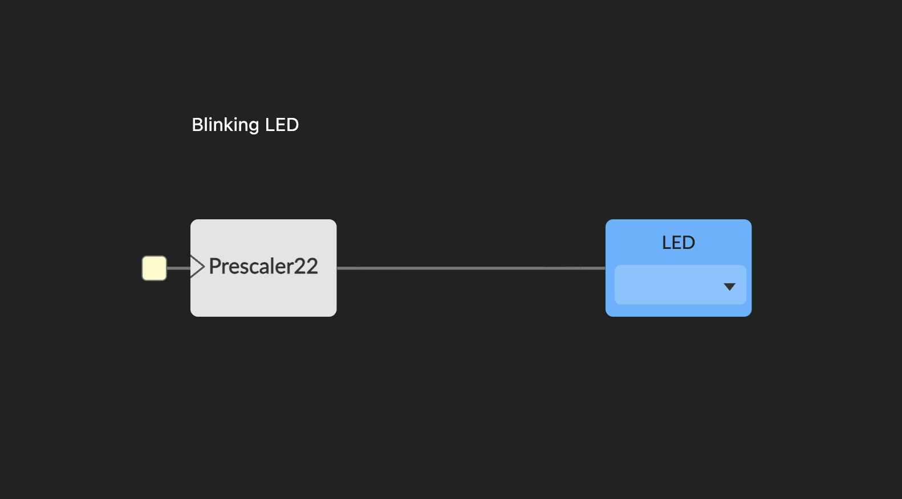
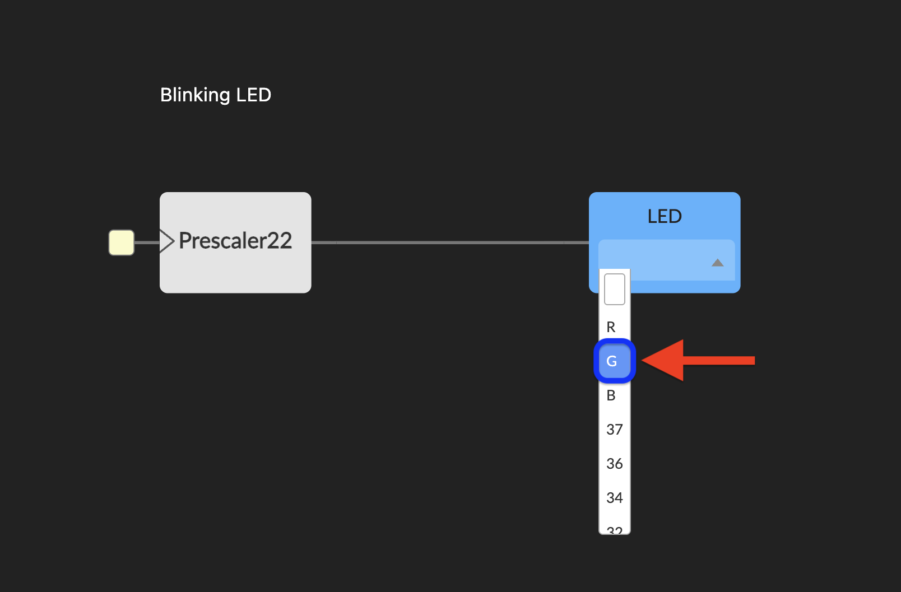
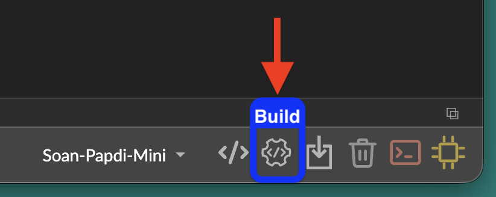
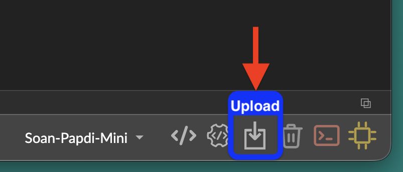

 

<video
  controls
  autoplay
  muted
  loop
  playsinline
  width="100%"
  style="border-radius: 12px; overflow: hidden;">
  <source src="/videos/mini/icestudio-green-led-blink.mp4" type="video/mp4">
</video>

In this project, we'll build the classic **"Hello, World!"** of hardware: blinking the **Green** channel of the onboard RGB LED on the **Soan Papdi Mini** using **iCE Studio's** visual logic blocks.

<!-------------------------------------------------------------------------->

 

## What You'll Need

- A **[Soan Papdi Mini ↗](https://www.ashoktinkeringlabs.com/soan-papdi-mini)** FPGA board.
- A **USB-C data cable** (make sure it supports data transfer, not just charging).
- **iCE Studio** installed with the Apio toolchain ([Installation Guide](../installing-ice-studio/)).

<!-------------------------------------------------------------------------->

 

## How FPGAs Work (The Basics)

Before we start wiring blocks, let's take a quick look at what happens inside an FPGA.

Think of an **FPGA (Field Programmable Gate Array)** as a giant box of digital LEGO blocks. Unlike a traditional microcontroller (MCU) that executes software instructions one line at a time, an FPGA lets you physically wire up real digital circuits inside the silicon chip.

*Image Source: [Lattice Semiconductor ↗](https://www.latticesemi.com/en/What-is-an-FPGA)*

In this project, we'll wire the board's **12 MHz clock** through a **frequency divider (prescaler)** directly to the **Green RGB LED pin**, creating a dedicated hardware circuit that blinks the LED automatically.

<!-------------------------------------------------------------------------->

 

## Step-by-Step Tutorial

{}

### Select the Board

First, tell iCE Studio that we're building for the **Soan Papdi Mini**:

1. Look at the **bottom-right corner** of the iCE Studio window.
2. Click the **Select board** dropdown icon.
3. Choose **Soan Papdi Mini** from the list.

You'll see **`Soan-Papdi-Mini`** confirmed in the bottom-right corner of the workspace:

### Open the LED Blink Example

Open the built-in LED Blink example from the top menu bar: \
**File → Examples → Basic → 04. One LED Blink.ice**

When you open the example, iCE Studio will ask to convert the default pin mappings to match the **Soan Papdi Mini**:

- Click **`Convert`** to continue.

### Understand the Blocks & Select the Pin

#### How the Circuit Works

- **`Input Clock (Yellow Block)`**: Provides the heartbeat of the FPGA—a fast **12 MHz** clock signal ticking 12 million times every second.
- **`Prescaler22`**: Acts like a gear reducer. A 12 MHz signal blinks far too fast for the human eye to see. `Prescaler22` uses a 22-bit counter to divide the clock by `2²²` (`4,194,304`), slowing 12 MHz down to roughly **3 blinks per second** (`~2.86 Hz`).
- **`Output Pin Block`**: Connects the slowed pulse directly to a physical pin on the board, turning the LED on and off in sync with the counter.

#### Choose the Green LED Pin (`G`)

Click the dropdown on the output block and select **`G`** (the **Green** channel of the onboard RGB LED):

### Build Your Project

Now that our circuit is ready, we need to **Build** it. Building synthesizes your visual blocks into a **bitstream** file that configures the FPGA's internal logic gates.

- Click the **Build** button in the bottom-right corner of iCE Studio:

### Upload to Soan Papdi Mini

Once `"Build done"` appears, you're ready to flash the bitstream onto your **Soan Papdi Mini**.

#### Step A: Put the Board in Programming Mode {class="no-step-marker"}

Follow this button sequence on your **Soan Papdi Mini**:

1. **Press and hold** the **PROG** button.
2. While holding **PROG**, **press and release** the **RESET** button.
3. The **Blue RGB LED** will turn on.
4. **Release** the **PROG** button.
5. The **White RGB LED** will begin breathing/blinking—confirming the board is in **Programming Mode** and ready to receive your circuit.

 

<video
  controls
  autoplay
  muted
  loop
  playsinline
  width="100%"
  style="border-radius: 12px; overflow: hidden;">
  <source src="/videos/soan-papdi-mini-programming.mp4" type="video/mp4">
</video>


**Tip:** If an upload ever fails, double-check that your board's white LED is blinking in **Programming Mode** before clicking **Upload**!


#### Step B: Upload the Bitstream {class="no-step-marker"}

1. Click the **Upload** button in the bottom-right corner of iCE Studio:

2. Wait a few seconds for `"Upload done"` to appear.
3. Press the **RESET** button on your **Soan Papdi Mini** once to exit Programming Mode and start running your new hardware design!

 

<video
  controls
  autoplay
  muted
  loop
  playsinline
  width="100%"
  style="border-radius: 12px; overflow: hidden;">
  <source src="/videos/mini/icestudio-green-led-blink.mp4" type="video/mp4">
</video>

**Congratulations! 🎉** You've just synthesized and uploaded your first real digital circuit onto the Soan Papdi Mini.

{}

<!-------------------------------------------------------------------------->

 

## Try It Yourself!

Want to experiment with your circuit right away? Try these quick modifications and re-upload:
- **Change the Color**: Switch the output pin dropdown from **`G`** to **`R`** (Red) or **`B`** (Blue) to blink a different color channel of the RGB LED.
- **Change the Blink Speed**: Click the **`22`** parameter box feeding into `PrescalerN` and change it to **`21`** (blinks twice as fast) or **`23`** (blinks half as fast).


  

