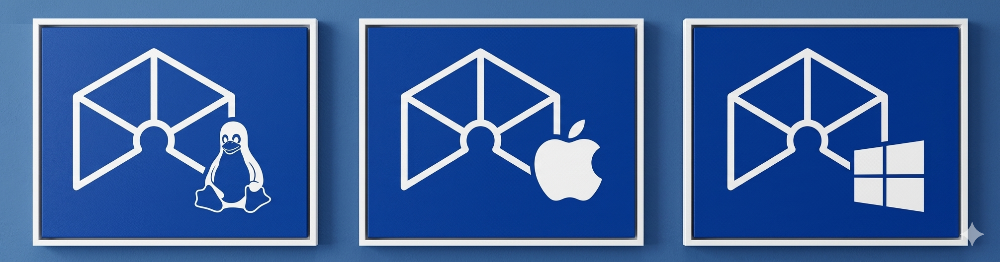
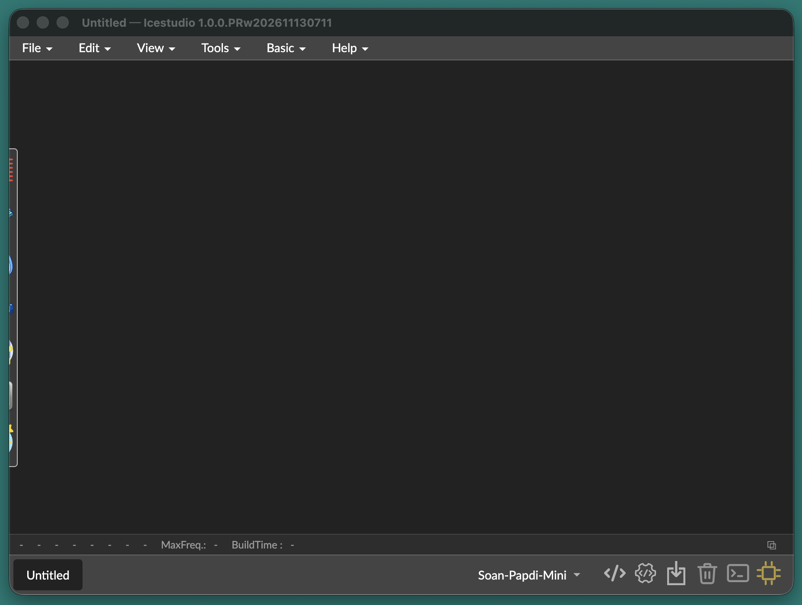
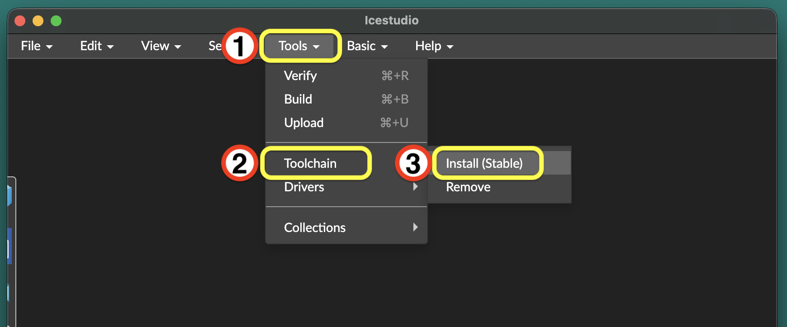
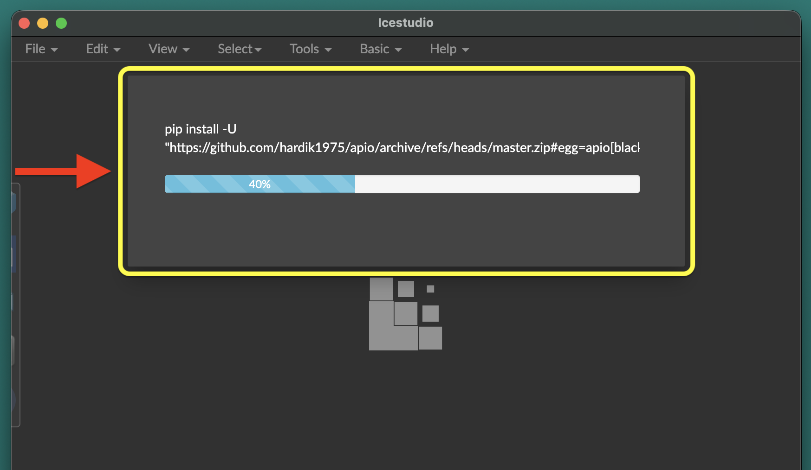
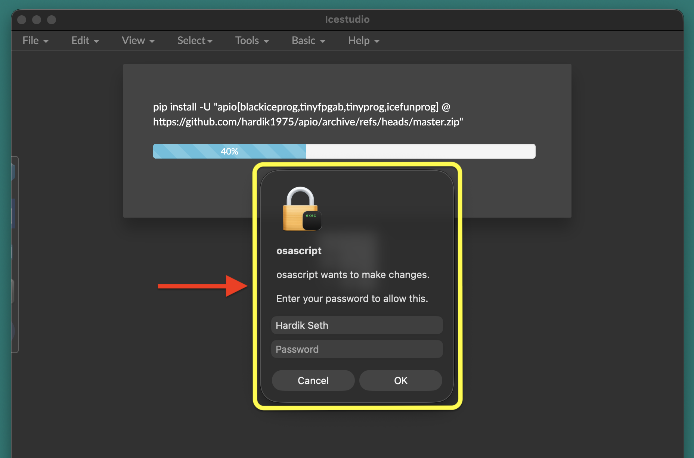
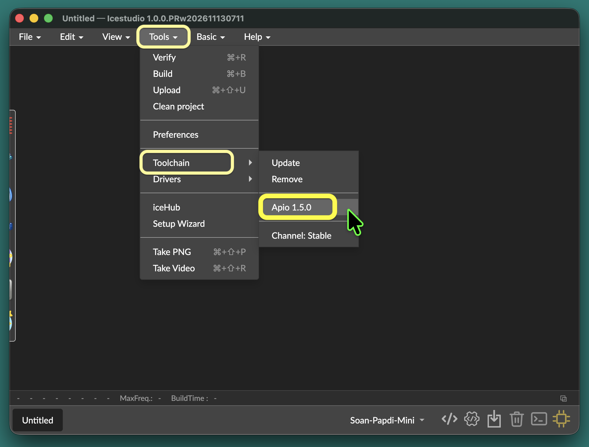

In this guide, you'll download **iCE Studio** and set up the built-in FPGA toolchain required to program your **Soan Papdi Mini** board. By the end, your development environment will be ready to build and upload your first circuit.

<br>

## Prerequisites

Before installing, make sure you have:

1. **A Computer** — Running **Windows**, **macOS**, or **Linux**.
2. **An Active Internet Connection** — Required to download iCE Studio and fetch the open-source FPGA toolchain packages.
3. **Python 3.12 or later** — Required by the underlying Apio toolchain ([Download Python ↗](https://www.python.org/downloads/)).

<!-------------------------------------------------------------------------->

<br>

## Installation Guide

{}

### Download iCE Studio



Download the **Soan Papdi Mini** build of iCE Studio for your operating system:


  
  
  


### Open iCE Studio

Install iCE Studio just like any other desktop application and launch it for the first time:



When the workspace opens, you'll see a notification in the bottom-right corner saying: \
`"Toolchain not installed. Click here to install it"` — that's what we'll set up in the next step.


**macOS Users: See an `"icestudio.app is damaged"` alert?** \
macOS Gatekeeper may block unsigned apps downloaded from the browser. Open **Terminal** and run:
```bash
xattr -c /Applications/icestudio.app
```


### Install the Toolchain (Apio)

Before you can synthesize and upload circuits to your **Soan Papdi Mini**, iCE Studio needs its open-source FPGA toolchain (**Apio**). Think of it as the engine that compiles your visual blocks into hardware.

In the top menu bar, go to **Tools → Toolchain → Install (Stable)**:



iCE Studio will begin downloading and configuring the required packages automatically:



During installation, you may be prompted for your system password so iCE Studio can configure drivers and system dependencies:



### Verify the Toolchain Installation

Once the installation completes, confirm that everything is ready to go.

Open **Tools → Toolchain** from the top menu bar and verify that **Apio 1.5.0** is displayed as installed:



**You're all set! 🎉** iCE Studio and the FPGA toolchain are now installed and ready for your Soan Papdi Mini.

### Build Your First Circuit

Now that your environment is ready, create your first visual FPGA project and blink the onboard RGB LED on your Soan Papdi Mini:


  


{}
