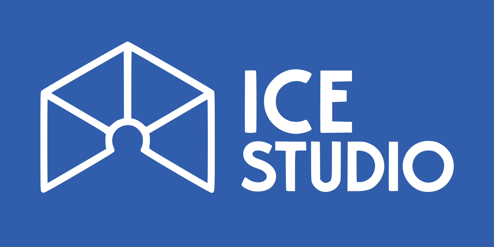

**iCE Studio** is an open-source visual FPGA design tool that lets you create real digital circuits for the **Soan Papdi Mini** by connecting graphical blocks instead of writing raw Verilog code.

[**Official iCE Studio Documentation ↗**](https://icestudio.readthedocs.io/en/latest/)

<!-------------------------------------------------------------------------->

 

## Visual Hardware Design Made Simple

Traditional FPGA tools often have a steep learning curve with complex IDE setups and strict Hardware Description Language (HDL) syntax. **iCE Studio** removes that barrier with an intuitive drag-and-drop canvas where you can place logic gates, counters, clocks, and I/O pins, wire them together visually, and upload them directly to your board.

With iCE Studio, you can focus on understanding digital logic and hardware concepts first—and as you gain confidence, you can even create custom **Verilog code blocks** right inside your visual diagrams before transitioning to a full command-line workflow.

 


**What's happening under the hood?**

When you click **Build** or **Upload**, iCE Studio isn't running an interpreter on the board—it generates real hardware:
* **Visual-to-Verilog**: Converts your block diagram into standard Verilog HDL.
* **Synthesis & Place-and-Route**: Uses the open-source **Apio** toolchain (**Yosys** + **nextpnr**) behind the scenes to map your circuit onto the iCE40UP5K FPGA.
* **Direct USB Flashing**: Packages the bitstream and flashes it straight to your **Soan Papdi Mini** over USB-C.


<!-------------------------------------------------------------------------->

 

## Why use iCE Studio?


  
  
  
  

