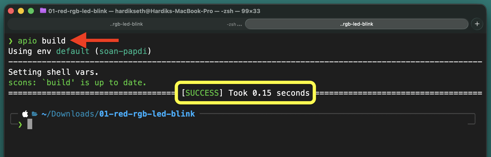
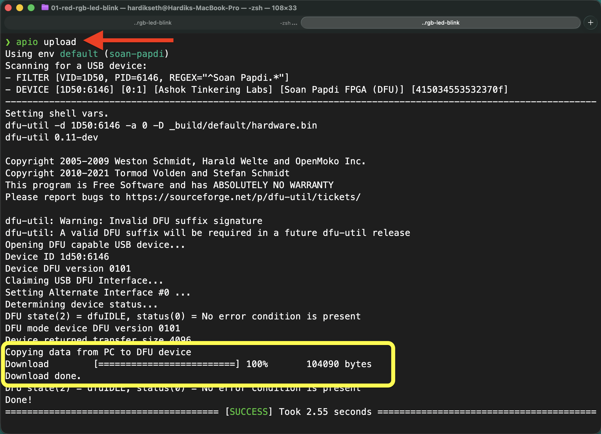

<br>

<video
  controls
  autoplay
  muted
  loop
  playsinline
  width="100%"
  style="border-radius: 12px; overflow: hidden;">
  <source src="/videos/mini/blink-red-led.mp4" type="video/mp4">
</video>


In this tutorial, you'll build, synthesize, and upload a complete **Verilog** hardware design on the **Soan Papdi Mini** using the **Apio CLI** to blink the **Red channel** of the onboard RGB LED.


  


<!-------------------------------------------------------------------------->

<br>

## Hardware & Pin Configuration

Because the **Soan Papdi Mini** includes an onboard **RGB LED** and a **12 MHz clock oscillator**, no external wiring or breadboard components are required for this example!

| Signal in Verilog | Hardware Component | Physical FPGA Pin | Notes |
| :--- | :--- | :--- | :--- |
| **`clk`** | Onboard 12 MHz Oscillator | **Pin 35** | Ticks 12,000,000 times per second |
| **`led_r`** | Onboard RGB LED (**Red** / RGB1) | **Pin 40** | **Active-Low** |


**Active-Low RGB LED:** \
The onboard RGB LED on the Soan Papdi Mini is **Active-Low**. Driving the pin to logic **`0`** (LOW) turns the LED **ON**, and driving it to logic **`1`** (HIGH) turns the LED **OFF**.
*(Want to check other pins? View the full [Soan Papdi Mini Pin Diagram](/mini/hardware-overview/#pin-diagram)).*


<!-------------------------------------------------------------------------->

<br>

## Step-by-Step Guide

{}

### Download & Open the Example Project

Download the ready-to-run project archive using the button below and extract it on your computer:

<div style="margin: 1rem 0 1.5rem 0;">
  <a href="/downloads/01-red-rgb-led-blink.zip" download style="display: inline-flex; align-items: center; gap: 8px; padding: 10px 22px; border-radius: 8px; text-decoration: none; font-weight: 600; background: #3b82f6; color: white;">
     Download Example (01-red-rgb-led-blink.zip)
  </a>
</div>

Once extracted, open your terminal and navigate into the project folder:

```bash
cd 01-red-rgb-led-blink
```

*(Alternatively, you can create a new folder named `01-red-rgb-led-blink` and copy the three files below into it).*

### Explore the Project Files

An Apio project for the **Soan Papdi Mini** consists of three files:

```text
01-red-rgb-led-blink/
│
├── apio.ini       → Target board & top-level module configuration
├── pins.pcf       → Physical FPGA pin mappings for Soan Papdi Mini
└── blink.v        → Verilog hardware design
```

Let's examine each file in detail.

#### 1. `apio.ini` {class="no-step-marker"}

This configuration file tells Apio which FPGA board you are targeting and the name of your top-level Verilog module:

```ini
[env:default]
board = soan-papdi
top-module = blink
```

- **`board = soan-papdi`** : Configures the synthesis and DFU programmer tools for the Soan Papdi Mini.
- **`top-module = blink`** : Specifies the entry-point module name inside `blink.v`.

#### 2. `pins.pcf` {class="no-step-marker"}

The Physical Constraints File (`.pcf`) connects the signal names in your Verilog code to the physical pins on the **Soan Papdi Mini**:

```text
# 12 MHz Onboard Clock Oscillator
set_io clk 35

# Onboard RGB LED - Red Channel (Active-Low)
set_io led_r 40
```

- **`set_io clk 35`** : Connects `clk` to **Pin 35** (the onboard 12 MHz crystal oscillator).
- **`set_io led_r 40`** : Connects `led_r` to **Pin 40** (the **Red** channel of the onboard RGB LED).

#### 3. `blink.v` {class="no-step-marker"}

This is your hardware description file. It divides the high-speed 12 MHz clock down to toggle the Red RGB LED every **0.5 seconds** (a 1 Hz blink rate):

```verilog
// ============================================================================
// Project : Soan Papdi Mini - Onboard Red RGB LED Blink
// Board   : Soan Papdi Mini (Lattice iCE40UP5K-SG48)
// Clock   : 12 MHz (Pin 35)
// Red LED : Pin 40 (Active-Low: 0 = ON, 1 = OFF)
// ============================================================================

module blink (
    input  wire clk,
    output reg  led_r = 1'b1
);

    // 12 MHz clock = 12,000,000 ticks per second
    // Toggle every 6,000,000 ticks (0.5 seconds) -> 1 Hz blink (0.5s ON, 0.5s OFF)
    localparam HALF_SECOND = 6_000_000;

    reg [22:0] counter = 23'd0;

    always @(posedge clk) begin
        if (counter >= HALF_SECOND - 1) begin
            counter <= 23'd0;
            led_r   <= ~led_r;
        end else begin
            counter <= counter + 1'b1;
        end
    end

endmodule
```

### Understand the Verilog Logic

Unlike software that executes sequentially on a CPU, Verilog describes physical digital circuits—counters, comparators, and flip-flops—wired together inside the FPGA. Here is how `blink.v` works:

#### 1. Module Declaration {class="no-step-marker"}

```verilog
module blink (
    input  wire clk,
    output reg  led_r = 1'b1
);
```

- **`input wire clk`**: Receives the continuous 12 MHz clock signal from Pin 35.
- **`output reg led_r = 1'b1`**: Declared as a "reg" (register) because it holds its state ("0" or "1") between clock cycles inside an `always` block. Initializing it to `1'b1` starts the active-low Red LED in the **OFF** state.

#### 2. Time-to-Clock Math {class="no-step-marker"}

```verilog
localparam HALF_SECOND = 6_000_000;
```

If we toggled the LED directly on every 12 MHz clock tick, it would flash millions of times per second—far too fast for the human eye to see. To make it toggle every **0.5 seconds**:
- **Clock Frequency**: 12,000,000 Hz (12 million ticks per second)
- **0.5 Second Ticks**: 12,000,000 × 0.5 s = 6,000,000 clock cycles
- **Full Blink Period**: 0.5 s ON + 0.5 s OFF = 1.0 second (1 Hz)

#### 3. Register Bit Sizing {class="no-step-marker"}

```verilog
reg [22:0] counter = 23'd0;
```

In hardware, every bit of a register is a physical flip-flop on the FPGA. To count up to 6,000,000, we need a 23-bit register ([22:0]), since 2²³ = 8,388,608 (whereas 22 bits only reaches 4,194,304).

#### 4. Synchronous Counter & LED Toggle {class="no-step-marker"}

```verilog
always @(posedge clk) begin
    if (counter >= HALF_SECOND - 1) begin
        counter <= 23'd0;
        led_r   <= ~led_r;
    end else begin
        counter <= counter + 1'b1;
    end
end
```

- **`always @(posedge clk)`**: Triggers on every rising edge of the 12 MHz clock.
- **Counting & Toggling**: On each clock tick, counter increments by 1. Once it reaches 5,999,999 (6 million ticks total, starting from 0), it resets back to 0 and inverts led_r, flipping the Red LED between **ON** (0) and **OFF** (1).

### Build & Upload to Soan Papdi Mini

Now let's synthesize your Verilog code and flash it onto the **Soan Papdi Mini**!

#### Step A: Enter Programming Mode {class="no-step-marker"}

Connect your **Soan Papdi Mini** to your computer using a USB-C data cable and put it into **Programming Mode**:

1. **Press and hold** the **PROG** button.
2. While holding **PROG**, **press and release** the **RESET** button.
3. The **Blue RGB LED** will turn on.
4. **Release** the **PROG** button.
5. The **White RGB LED** will start blinking—confirming the board is in **Programming Mode**.

<br>

<video
  controls
  autoplay
  muted
  loop
  playsinline
  width="100%"
  style="border-radius: 12px; overflow: hidden;">
  <source src="/videos/soan-papdi-mini-programming.mp4" type="video/mp4">
</video>

#### Step B: Verify USB Connection {class="no-step-marker"}

Check that Apio detects your board in DFU Programming Mode:

```bash
apio devices scan-usb
```


#### Step C: Build the Bitstream {class="no-step-marker"}

Run `apio build` inside your project folder to synthesize `blink.v` and generate the FPGA bitstream:

```bash
apio build
```



#### Step D: Upload to the Board {class="no-step-marker"}

Flash the compiled bitstream to your **Soan Papdi Mini**:

```bash
apio upload
```



Once the upload finishes, **press the RESET button** on your **Soan Papdi Mini**. The onboard **Red RGB LED** will immediately start blinking on and off every half second!

<video
  controls
  autoplay
  muted
  loop
  playsinline
  width="100%"
  style="border-radius: 12px; overflow: hidden;">
  <source src="/videos/mini/blink-red-led.mp4" type="video/mp4">
</video>

{}

<!-------------------------------------------------------------------------->

<br>

## Try Customizing It

Want to experiment with your Verilog hardware design? Try these quick changes and run `apio upload` again:

- **Change the Blink Speed**: Change `localparam HALF_SECOND = 6_000_000;` in `blink.v` to `1_500_000` to make the Red LED blink **4× faster**.
- **Switch RGB Colors**: Edit `pins.pcf` to map the output to a different channel of the onboard RGB LED:
  - **Red (R)**: set_io led_r 40
  - **Green (G)**: set_io led_r 41
  - **Blue (B)**: set_io led_r 39

<br>

## Bonus: Visualize Your Synthesized Circuit

Want to see the actual digital logic gates and flip-flops Apio synthesized from your Verilog code? Run:

```bash
apio graph
```

Apio will generate a schematic diagram of your hardware counter and comparator circuit so you can inspect how your Verilog code maps to physical logic gates!
