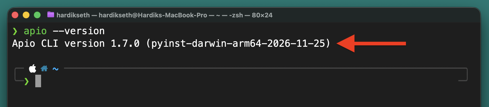
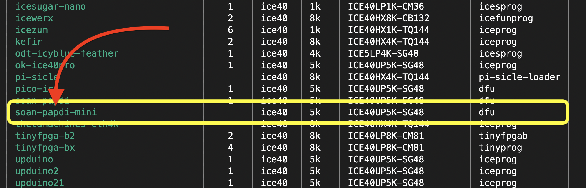

Ready to start writing Verilog for your **Soan Papdi Mini**? Let's install the **Apio CLI** and configure its open-source FPGA toolchain on your machine.

<br>

## Prerequisites

Before installing Apio, make sure you have:
- **Python 3.12 or later** installed on your system ([Download Python ↗](https://www.python.org/downloads/)).
- An active **internet connection** to download Apio and the iCE40 toolchain packages.

<!-------------------------------------------------------------------------->

<br>

## Setup Guide

{}

### Install Apio

You can install the Apio CLI directly via `pip` (Python's package manager) by running:

```bash
pip install -U apio
```

Alternatively, you can use an isolated environment (`pipx`) or download a standalone bundle for your operating system from the official [**Apio CLI Installation Guide ↗**](https://fpgawars.github.io/apio/docs/installing-apio-cli/).


### Verify the Installation

Once installed, confirm that Apio is accessible from your terminal or command prompt:

```bash
apio --version
```

You should see the installed version printed in your terminal (for example, `Apio CLI version 1.7.0`):



### Download Toolchain & Board Packages

Apio supports dozens of FPGA boards out of the box and automatically manages its open-source synthesis and programmer packages (`oss-cad-suite`). To fetch the latest board definitions and required packages, run:

```bash
apio boards
```

Apio will connect to the internet and download the latest board and toolchain definitions automatically:


### Confirm Board Support

Once the download finishes, Apio will print a table of supported FPGA boards. Verify that **Soan Papdi** / **Soan Papdi Mini** is listed in the output:



**That's it! 🎉** Your Apio CLI environment is installed and ready to synthesize Verilog code.

{}

<!-------------------------------------------------------------------------->

<br>

## Anatomy of an Apio Project

Before writing your first module, it helps to know how an Apio project is organized. Every Apio project folder contains three essential files:

| File | Purpose |
| :--- | :--- |
| **`apio.ini`** | Project configuration file that tells Apio which target board and top-level Verilog module you are using. |
| **`pins.pcf`** | Physical Constraints File that maps human-readable signal names in your Verilog code (like `LED_R` or `CLK`) to physical FPGA pin numbers. |
| **`main.v`** | Your Verilog hardware design (for example, `blink.v`). |

<br>

## Next Step: Build Your First Project

Now that Apio is set up, let's create a complete Verilog project from scratch to blink the onboard **Red RGB LED** on your Soan Papdi Mini:


  

